<div align="center">
<a href="https://astral-dust.onrender.com"></a>

<p>
<a href="https://astral-dust.onrender.com"></a>&nbsp;
<a href="https://github.com/priyanshusharan-cmd/astral-dust/releases/latest"></a>
</p>
<p>
<a href="https://github.com/priyanshusharan-cmd/astral-dust/releases/latest"></a>
<a href="https://astral-dust.onrender.com"></a>
<a href="LICENSE"></a>


</p>
<sub>
<a href="#-see-it-move">DEMO</a> &nbsp;✦&nbsp;
<a href="#-the-gestures">GESTURES</a> &nbsp;✦&nbsp;
<a href="#-features">FEATURES</a> &nbsp;✦&nbsp;
<a href="#-how-it-works">HOW IT WORKS</a> &nbsp;✦&nbsp;
<a href="#-download">DOWNLOAD</a> &nbsp;✦&nbsp;
<a href="#-run-it-locally">RUN LOCALLY</a>
</sub>
</div>

<br/>


## ✦ See it move

<div align="center">
  <video src="https://github.com/user-attachments/assets/03a3d798-c767-41ad-aa35-2ba6caf824fa" width="800" autoplay loop muted playsinline></video>
</div>

<br/>

**Astral Dust** turns your webcam into a controller for a sphere made of 3,200 glowing particles. Google's **MediaPipe** tracks 21 landmarks on each hand in real time, a small hand-written physics engine turns those landmarks into forces, and **Three.js** renders the dust with additive blending and an Unreal bloom pass, layered straight over your camera feed.

You don't need a headset, a controller or an account. Open the page, raise a hand, and the dust follows you.

> [!TIP]
> Works best in Chrome or Edge on a laptop with a decent webcam. Keep your hand roughly 40–80 cm from the camera.


## ✦ The gestures

<table>
  <tr>
    <td width="33%"></td>
    <td width="33%"></td>
    <td width="33%"></td>
  </tr>
  <tr>
    <td width="33%"></td>
    <td width="33%"></td>
    <td width="33%"></td>
  </tr>
  <tr>
    <td width="33%"></td>
    <td width="33%"></td>
    <td width="33%"></td>
  </tr>
</table>

<details>
<summary><b>Full gesture reference</b></summary>
<br/>

| Gesture | State | What happens |
| :-- | :--: | :-- |
| ✋ &nbsp;Show one open palm | `FOLLOW` | The sphere locks onto the centre of your palm and glides after it. |
| 🤏 &nbsp;Pinch thumb + index | `PINCH` | The sphere collapses into a tiny, dense ball of light. |
| 🖐 &nbsp;Release the pinch | `SCATTER` | A big-bang burst flings the dust across the screen, where it bounces off the edges. |
| ✋ &nbsp;Show a palm after scattering | `GATHER` | The loose dust drifts back into a swirling cloud around your hand. |
| ✊ &nbsp;Close your fist | `FOLLOW` | The cloud snaps back into a perfect Fibonacci sphere. |
| 🙌 &nbsp;Show two palms | `TWO_HAND` | The distance between your hands sets the size of the sphere. |
| 🙌 &nbsp;Two palms after scattering | `SPLIT` | The dust divides into two clouds, one per hand. Each hand can pinch on its own. |
| 👏 &nbsp;Bring both palms together | — | The halves merge into one compressed ball. Spread your hands to grow it again. |
| ⌨️ &nbsp;Press <kbd>C</kbd> | — | Turns the camera feed behind the particles on or off. |

</details>


## ✦ Features

<table>
  <tr>
    <td width="33%" valign="top">
      <h3>🖐 Real-time hand tracking</h3>
      MediaPipe's Hand Landmarker runs on the GPU in your browser, tracks up to two hands and smooths every landmark to remove jitter.
    </td>
    <td width="33%" valign="top">
      <h3>🌌 Fibonacci sphere</h3>
      3,200 particles are spread over a golden-angle spiral for a perfectly even sphere, with a second volumetric layout for the loose cloud form.
    </td>
    <td width="33%" valign="top">
      <h3>⚛️ Spring physics</h3>
      Every particle is pulled by a damped spring toward its target. Scatters add radial impulses, and particles bounce inside the screen bounds.
    </td>
  </tr>
  <tr>
    <td width="33%" valign="top">
      <h3>🎨 Adaptive colour</h3>
      The webcam frame is sampled four times a second. The dust turns cyan in bright rooms, magenta under indoor light and gold in the dark.
    </td>
    <td width="33%" valign="top">
      <h3>✨ Cinematic glow</h3>
      Soft radial star sprites, additive blending and an Unreal bloom pass give every particle a halo without blowing out to white.
    </td>
    <td width="33%" valign="top">
      <h3>🔒 Private by design</h3>
      Video never leaves your device. All tracking happens locally in the browser, and the server only hands out static files.
    </td>
  </tr>
</table>


## ✦ How it works

Every frame runs the same short loop: read the webcam, find the hands, decide the gesture, move the particles, render.

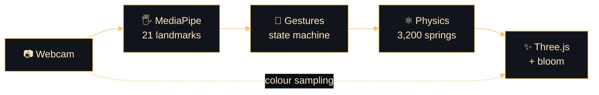

<details>
<summary><b>The gesture state machine</b></summary>
<br/>

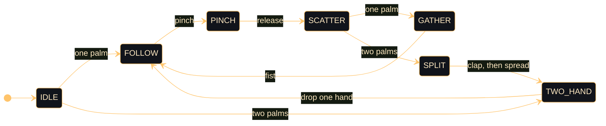

</details>

<details>
<summary><b>Project structure</b></summary>
<br/>

```text
astral-dust/
├── server.js                 Express static server (opens your browser automatically)
├── package.json              scripts + pkg targets for the desktop builds
└── public/
    ├── index.html            loading screen, HUD and import map
    ├── css/styles.css        frosted-glass HUD and full-screen layering
    └── js/
        ├── main.js           animation loop, adaptive colour, HUD updates
        ├── handTracking.js   webcam + MediaPipe Hand Landmarker
        ├── coordinateMapper.js  landmark → 3D world mapping
        ├── gestures.js       gesture detection and state machine
        ├── particles.js      Fibonacci sphere + cloud buffers
        ├── physics.js        springs, damping, scatter impulses
        └── scene.js          Three.js renderer + bloom post-processing
```

</details>


## ✦ Download

The desktop builds bundle the server and the app into a single file. Run it and Astral Dust opens in your default browser at `http://localhost:3000`.

<div align="center">

| Platform | File | |
| :-- | :-- | :--: |
| 🍎 &nbsp;macOS · Apple Silicon | `astral-dust-macos-arm64` | [**Download**](https://github.com/priyanshusharan-cmd/astral-dust/releases/latest/download/astral-dust-macos-arm64) |
| 🍏 &nbsp;macOS · Intel | `astral-dust-macos-x64` | [**Download**](https://github.com/priyanshusharan-cmd/astral-dust/releases/latest/download/astral-dust-macos-x64) |
| 🪟 &nbsp;Windows · x64 | `astral-dust-win-x64.exe` | [**Download**](https://github.com/priyanshusharan-cmd/astral-dust/releases/latest/download/astral-dust-win-x64.exe) |
| 🐧 &nbsp;Linux · x64 | `astral-dust-linux-x64` | [**Download**](https://github.com/priyanshusharan-cmd/astral-dust/releases/latest/download/astral-dust-linux-x64) |

</div>

<details>
<summary><b>macOS or Linux says the file can't be opened?</b></summary>
<br/>

The builds aren't code-signed, so mark the file as executable and clear the quarantine flag once:

```bash
chmod +x astral-dust-macos-arm64
xattr -d com.apple.quarantine astral-dust-macos-arm64
./astral-dust-macos-arm64
```

On Windows, choose **More info → Run anyway** if SmartScreen shows a warning.

</details>


## ✦ Run it locally

You'll need [Node.js](https://nodejs.org) 18 or newer.

```bash
git clone https://github.com/priyanshusharan-cmd/astral-dust.git
cd astral-dust
npm install
npm start
```

Your browser opens at [http://localhost:3000](http://localhost:3000). Allow camera access when asked, and raise a hand.

<details>
<summary><b>Build the desktop apps yourself</b></summary>
<br/>

```bash
npm run build
```

[`pkg`](https://github.com/vercel/pkg) writes binaries for macOS (arm64 + x64), Windows and Linux to `dist/`.

</details>

<details>
<summary><b>Deploy your own copy</b></summary>
<br/>

Astral Dust is a plain Express app, so any Node host works. On [Render](https://render.com), create a **Web Service** with:

- **Build command:** `npm install`
- **Start command:** `npm start`
- **Environment:** `NODE_ENV=production` (stops the server from trying to open a browser)

The server reads `PORT` from the environment. Webcams need a secure context, so serve over HTTPS.

</details>

<details>
<summary><b>Troubleshooting</b></summary>
<br/>

- **Stuck on "Requesting camera access…"**: allow the camera for your browser in your system's privacy settings, then reload.
- **Hands aren't detected**: add some light in front of you and keep your whole hand in frame.
- **Low frame rate**: close other tabs that use the GPU, or try Chrome with hardware acceleration turned on.
- **Particles look washed out**: press <kbd>C</kbd> to hide the camera feed and watch the dust on pure black.

</details>

<br/>


<div align="center">

<br/>

Crafted by **[Priyanshu Sharan](https://github.com/priyanshusharan-cmd)** &nbsp;·&nbsp; Released under the [MIT License](LICENSE)

<sub>If Astral Dust made you smile, a ⭐ helps other people find it.</sub>

</div>
